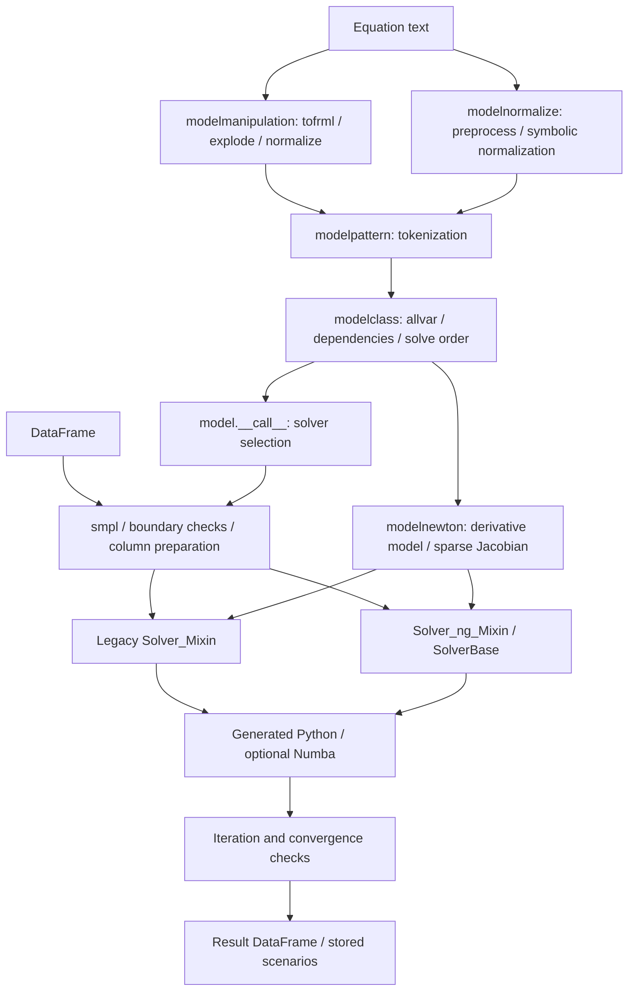

# ModelFlow correctness review — 10 October 2026

Reviewed the working-tree execution core in `C:/modelflow2/modelflow`. No production code was modified. The scripts and logs in this directory are review artifacts. This is a targeted correctness review, not a claim that every repository file or solver option has been audited.

Ten findings were reproduced: six P1 issues involving incorrect numerical results and four P2 issues involving input handling or solver failures. P1 means fix soon because ordinary use can silently produce incorrect results; P2 means a narrower correctness issue. No P0 issue was established.

## Architecture and execution path



- `modelpattern.py` recognizes equation statements, operators, variable names, lags, leads, and fixed-period references. Token recognition currently uses regex `findall`.
- `modelmanipulation.py` expands the higher-level equation language, including loops, sums, and difference/log transformations. `model.from_eq` uses this route. `modelnormalize.py` supplies a separate preprocessing and symbolic-normalization route used by other onboarding workflows.
- `BaseModel` in `modelclass.py` turns tokens into variable metadata and builds dependency graphs. Topological ordering and prolog/core/epilog decomposition influence both automatic solver selection and iteration scope.
- Legacy `xgenr`, `sim`, `sim1d`, and Newton implementations remain in `modelclass.py`. New solvers in `modelsolver_ng.py` share setup, code generation, caching, convergence helpers, and result construction. The default call still selects legacy solvers for many normalized models; fixed-period and hybrid cases select newer paths.
- `modelnewton.py` generates symbolic or finite-difference derivative equations, evaluates them on DataFrames, and constructs per-period or stacked sparse Jacobians. Normalized equations use a derivative-minus-identity residual Jacobian; implicit equations need their residual convention preserved.
- Generated evaluators access NumPy arrays by integer row/column positions. Consequently, dtype preservation, cache invalidation, and sample-to-row mappings are part of numerical correctness, not merely performance details.

## Confirmed findings

### F1 — P1: Current-period self-dependencies disappear from the graph

Location: [modelclass.py:576](/C:/modelflow2/modelflow/modelclass.py:576), especially the `v.var != var` filter; automatic dispatch is at line 7257 onward.

**Trigger:** `model('Y=0.5*Y+X')`, a one-row float DataFrame with `Y=0`, `X=1`, then the ordinary `m(df, 2020, 2020)` call.

**Observed:** `m.istopo` is `True`; the default solver returns `Y=1`. The equation's solution is `Y=2`.

**Cause and consequence:** A contemporaneous self-edge is removed, so a simultaneous scalar equation is classified as a DAG and evaluated once. Forcing Gauss–Seidel does not reliably work around this because the graph-derived convergence core is empty. Self-dependencies need to be retained through cycle detection and decomposition, or these inputs must be explicitly rejected. The stacked feedback implementation already treats singleton self-loops as feedback nodes.

Reproduction: `probe.py`, case `selfloop`.

### F2 — P1: Gauss–Seidel accepts zero or NaN starting values as converged

Locations: [modelsolver_ng.py:662](/C:/modelflow2/modelflow/modelsolver_ng.py:662), [modelsolver_ng.py:1195](/C:/modelflow2/modelflow/modelsolver_ng.py:1195); equivalent legacy logic at [modelclass.py:7588](/C:/modelflow2/modelflow/modelclass.py:7588) and line 7943.

**Trigger:** A genuine two-variable cycle, `Y=0.5*Z+X; Z=Y`, initialized with `Y=Z=0`, `X=1`. This reproduction is separate from F1.

**Observed:** Default `sim` and `sim_ng` return `Y=1.984375`; `sim1d` and `sim1d_ng` return `Y=1.75`, instead of 2. Full newer Newton solvers return 2. With both unknowns initialized to NaN, `sim` and `sim_ng` announce that the period is solved and return NaNs.

**Cause and consequence:** The comparison baseline is captured before the iterations and remains unchanged until the first convergence test. The convergence helper tests only entries whose previous absolute value exceeds `absconv`. Starting at zero excludes every variable, even if it has since moved to an ordinary-sized value. NaN also fails the selection predicate. An empty selection passes. This defeats the requested relative tolerance and can silently validate unusable results. Update the baseline per iteration and check finite values and small-valued variables using an actual tolerance criterion.

Reproductions: `convergence`, `nanconv`.

**Follow-up recorded 11 October 2026 — fix to implement later:** Update `itbefore` on every non-breaking iteration, including the warm-up iterations before `first_test`. The first convergence test must compare the current sweep with the previous sweep, not with the initial values. Apply this consistently to legacy and newer 1D/2D Gauss–Seidel paths (`sim`, `sim_ng`, `sim1d`, `sim1d_ng`). Increasing `first_test` is not the fix; keep its existing timing semantics unless separately requested. Verify with the zero-initialized two-variable cycle above. Non-finite values and the small-value tolerance policy remain separate aspects of F2 to address explicitly. This records the fix only; no production changes have been made.

### F3 — P1: Solver caches share one column-layout marker

Locations: [modelclass.py:7443](/C:/modelflow2/modelflow/modelclass.py:7443), [modelsolver_ng.py:1034](/C:/modelflow2/modelflow/modelsolver_ng.py:1034), [modelsolver_ng.py:879](/C:/modelflow2/modelflow/modelsolver_ng.py:879).

**Trigger:** On one model instance for `Y=2*X`, run `sim_ng` with columns `[Y,X]`; run `xgenr_ng` with columns `[X,Y]`; then run `sim_ng` again with `[X,Y]`. The starting values in each input are `Y=0`, `X=3`.

**Observed:** The last call returns both `X=0` and `Y=0`, rather than preserving `X=3` and calculating `Y=6`. Also reproduced for `xgenr → sim → xgenr`, `sim → res → sim`, and `sim_ng → res_ng → sim_ng`.

**Cause and consequence:** Each evaluator has a separate code cache, but `genrcolumns` records only the most recently used layout across all solvers. A different solver can update the marker while leaving the first solver's code compiled against the old integer positions. The subsequent call sees no layout change and uses stale code. This can overwrite exogenous values in the returned DataFrame. Cache each evaluator's layout or invalidate all dependent evaluators when the layout changes.

Reproduction: `alignment`. Inputs themselves are copied; the demonstrated corruption is in the returned result.

### F4 — P1: Legacy file-based JIT can run equations from another model

Locations: [modelclass.py:7390](/C:/modelflow2/modelflow/modelclass.py:7390), [modelclass.py:7403](/C:/modelflow2/modelflow/modelclass.py:7403), [modelclass.py:7421](/C:/modelflow2/modelflow/modelclass.py:7421).

**Trigger:** In an isolated temporary directory, create a model named `review_jit` with `Y=2*X` and run `sim(..., ljit=True)`. Create another model with the same name and `Y=3*X`, and run it with the same float data (`X=3`).

**Observed:** Both calls return `Y=6`; the second must return 9. Reordering columns on the second instance then raises `UnboundLocalError` for `pro_jit`.

**Cause and consequence:** An existing source file is accepted based on its model-derived filename rather than its equations or layout, and `import_module` can also return the already-loaded module. The `newdata` branch does not always assign the functions before storing them. The result may therefore belong to an earlier model, especially with the default repeated model name. The newer `_import_transpiled` implementation already compares generated source and reloads changed modules; the legacy path does not have equivalent protection.

Reproduction: `jitcache`. Generated files were confined to a temporary review directory and removed afterwards.

### F5 — P1: Reduced per-period Newton silently skips implicit unknowns

Locations: [modelsolver_ng.py:2145](/C:/modelflow2/modelflow/modelsolver_ng.py:2145), [modelsolver_ng.py:2320](/C:/modelflow2/modelflow/modelsolver_ng.py:2320), with dependency construction at [modelclass.py:576](/C:/modelflow2/modelflow/modelclass.py:576).

**Trigger:** `Y=0.5*Z+X; Z___RES=Y-Z`, with `Y=Z=X=1`, solved using `newton_fbmin_ng`.

**Observed:** It returns `Y=1.5`, `Z=1`, leaving a residual of 0.5. `newton_ng`, `newtonstack_ng`, and `newtonstack_fbmin_ng` return `Y=Z=2` for the same problem.

**Cause and consequence:** The ordinary graph uses equation-output names, so `Z___RES` is endogenous while `Z` is not a graph node representing that unknown. The graph has no feedback set. `prepare` then selects a plain sweep, and the iteration treats the missing solver as convergence. A residual assignment never updates `Z`. Build the decomposition around declared unknowns and force residual equations into the solved set, or reject unsupported implicit/hybrid input for this solver. Its class documentation explicitly claims support for residual equations.

Reproduction: `hybrid`.

### F6 — P1: All-integer input arrays silently truncate numerical results

Locations: [modelclass.py:746](/C:/modelflow2/modelflow/modelclass.py:746), [modelclass.py:7553](/C:/modelflow2/modelflow/modelclass.py:7553), [modelsolver_ng.py:725](/C:/modelflow2/modelflow/modelsolver_ng.py:725).

**Trigger:** `Y=X/2` with all model columns already present as integers: `Y=0`, `X=3`.

**Observed:** `xgenr`, `xgenr_ng`, `sim`, and `sim_ng` return `Y=1`, not 1.5. A float input frame produces the expected result on the direct evaluators.

**Cause and consequence:** `DataFrame.values.copy()` retains integer dtype. Generated assignments then truncate floating-point results on each write. Missing-column insertion sometimes masks this by adding float columns, so adding an integer placeholder for an endogenous variable can change the numerical answer. Promote numeric working arrays to a floating dtype, with a separate object/matrix path where needed.

Reproduction: `integers`.

### F7 — P2: Tokenization silently deletes unsupported characters

Location: [modelpattern.py:205](/C:/modelflow2/modelflow/modelpattern.py:205); the same recognition strategy is used in `udtryk_parse` at line 385.

**Trigger:** Equations containing characters not consumed by the token regex, through either `model(...)` or `model.from_eq(...)`.

**Observed:** `Y=5 % 2` evaluates to 52; `Y=2 ^ 3` evaluates to 23; `Y=X+1 # +100` evaluates to 104 for `X=3`.

**Cause and consequence:** `findall` returns recognized tokens but never verifies that intervening text was consumed. Joining the numeric tokens can create a different valid expression. These examples need not be supported language features, but they must be rejected rather than silently reinterpreted. Python syntax validation in `from_eq` does not catch `%` and `^` because they are valid Python operators. Validate full lexical coverage and handle comments deliberately.

Reproduction: `parsing`.

### F8 — P2: Stacked Jacobian cache checks sample endpoints but not its length

Location: [modelsolver_ng.py:2531](/C:/modelflow2/modelflow/modelsolver_ng.py:2531).

**Trigger:** Solve `Y=0.5*Y(+1)+X` over 2020–2023 in a frame indexed 2020–2024. Remove the interior row 2021, then solve again on the same model with the same start/end labels.

**Observed:** First solve succeeds. Second raises `ValueError: b is of incompatible size` because the cached factorization is 4×4 and the new residual has three entries.

**Cause and consequence:** The cache condition compares only the first and last sample entries. Changes inside those endpoints are not detected. Store and compare the full sample/mapping (at least its length for this failure), rebuilding the factorization as needed. The API accepts generic positional indexes; if discontinuous temporal indexes are disallowed, that rule should instead be validated explicitly before solving.

Reproduction: `stackspan`. This finding concerns cache dimensions, not a claim that lag semantics should be calendar-based.

### F9 — P2: Newton cannot construct an empty derivative model

Location: [modelnewton.py:443](/C:/modelflow2/modelflow/modelnewton.py:443), consumed at line 473.

**Trigger:** Explicit `newton_ng` on the float-valued model `Y=X/2`, or `Y=X(-1)+2*X`. There are no contemporaneous endogenous RHS references to differentiate.

**Observed:** `AttributeError: The specification:"allvar" did not match a method, property or variable name`.

**Cause and consequence:** No derivative equations are generated; constructing `model('')` leaves the derivative model without `allvar`, which is then accessed during column insertion. Mathematically the normalized residual Jacobian is simply `-I`; this is not a singular problem. Handle the zero-derivative case directly or route it through a valid direct-evaluation path. Default recursive dispatch avoids the problem, so the scope is explicit Newton selection.

Reproduction: `emptyjac`.

### F10 — P2: MOVAVG argument splitting breaks on nested multi-argument expressions

Location: [modelnormalize.py:175](/C:/modelflow2/modelflow/modelnormalize.py:175).

**Trigger:** `normal('Y=MOVAVG(MAX(X,Z),2)', add_add_factor=False)`.

**Observed:** `ValueError: invalid literal for int() with base 10: 'Z),2'`.

**Cause and consequence:** Splitting on the first comma divides the inner `MAX` call instead of the outer `MOVAVG` arguments. Valid composite expressions cannot be normalized. Split at an outer-level comma using nesting-aware argument parsing.

Reproduction: `nestedavg`. Simple DIFF, DLOG, and LOG normalization controls pass.

## Validation and coverage

The completed validation run used Python 3.13.14 in the existing `book313` environment, importing the working-tree modules. Library versions: pandas 3.0.3, NumPy 2.4.6, SciPy 1.17.1, Numba 0.65.1, SymPy 1.14.0.

`validation.py` completed **17 passing groups**:

- A two-variable simultaneous linear model with positive initial values through ten solvers: legacy/new Gauss–Seidel 2D and 1D, legacy/new per-period Newton, legacy/new stacked Newton, and the two newer feedback solvers.
- Quarterly lag evaluation and forward-looking terminal-boundary cases on applicable solvers.
- Hybrid normalized/residual equations through the full newer Newton solvers and stacked feedback solver. The defective per-period feedback path is separately captured by F5.
- DIFF/DLOG/LOG normalization through both `from_eq` and `normal`.
- Symbolic and numerical stacked Jacobians compared with an explicitly constructed tridiagonal matrix.
- A three-variable linear system compared against `numpy.linalg.solve`, including six solver paths, chunk size 1, and legacy/new string-based Numba compilation.
- Existing `modeltest/fixedperiod_test.py` in full, including annual/quarterly/monthly fixed references, shifted index caching, rejection of unsupported in-span endogenous fixed references, and a string-JIT check.
- Existing `modeltest/fixedperiod_estimation_test.py` in full, including OLS/NLS and onboarding checks.

`probe.py` records the failing examples described above and catches expected exceptions so the other cases continue. It is a diagnostic runner, not a passing regression test suite. `probe.log` records actual outputs. The final healthy-path log is `validation_book313.log`; `validation.log` preserves the earlier interrupted Python 3.14 run.

The review examined the tokenization/normalization routes, graph and sample construction, solver dispatch, evaluator generation and caching, common convergence logic, full/reduced Newton setup, and Jacobian index assembly. The repository is substantially larger than this core. Examples, notebooks, archived `incomming` copies, the workbench/frontend, reporting, plotting, model inversion, and the broader estimation/import/export implementations were not comprehensively reviewed. The existing estimation test adds limited coverage, not a general estimator audit.

## Concerns and limits, not additional confirmed production bugs

- In the installed `modelflow314` environment, a standalone `scipy.linalg.lu_factor([[1.]])` terminated the process with exit code 1, both during reduced-solver validation and independently of ModelFlow. Running the suite outside the sandbox did not resolve it. Python 3.13 completed the same solver tests. This is an environment-level diagnostic lead, not evidence that ModelFlow's LU algorithm is defective.
- Newton derivative/factorization reuse across calls depends on caller options such as `nonlin` and `newton_reset`. The review did not establish that all nonlinear scenario changes are automatically safe. Reusing a factorization can be a deliberate modified-Newton strategy, so reuse alone is not reported as a bug.
- Nonconvergence is often printed while a DataFrame is still returned. The review did not define a new exception policy for existing APIs. Downstream acceptance of nonconverged results deserves a separate API-level review.
- Duplicate labels, timezone/DST behavior, sparse/extension dtypes, matrix-valued equations, user-function edge cases, alternate sparse factorization engines, all damping/split options, and large production economic models remain coverage gaps.
- Repository metadata was not resolved: `git status` failed with `cannot change to C:/modelflow2`. Findings refer to the inspected working-tree files and line numbers, not a verified commit SHA or clean-tree assertion.

## Re-running

From `C:/modelflow2/modelflow`, with an environment containing the project dependencies:

```powershell
& 'C:\Users\ibhan\miniforge3\envs\book313\python.exe' -B -u review_20261010\probe.py
& 'C:\Users\ibhan\miniforge3\envs\book313\python.exe' -B -u review_20261010\validation.py
```

The JIT probe uses an isolated temporary directory. The validation runner writes only review logs and uses in-memory/string-generated evaluators for its own compilation controls. Production modules were left unchanged.

